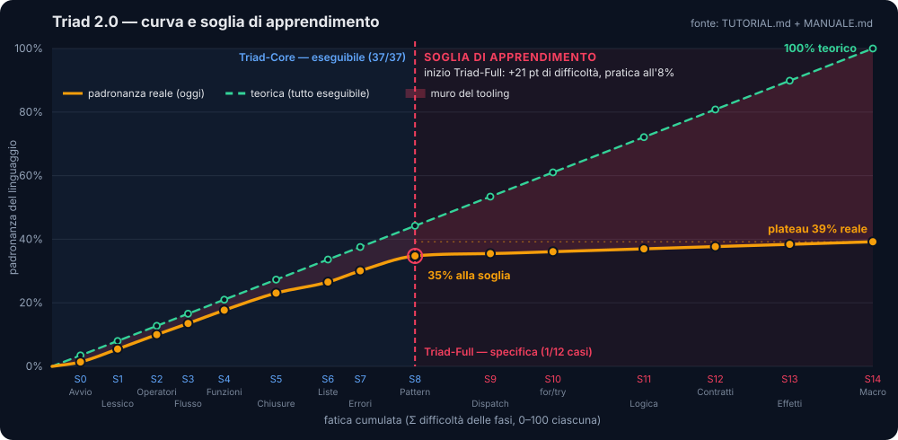
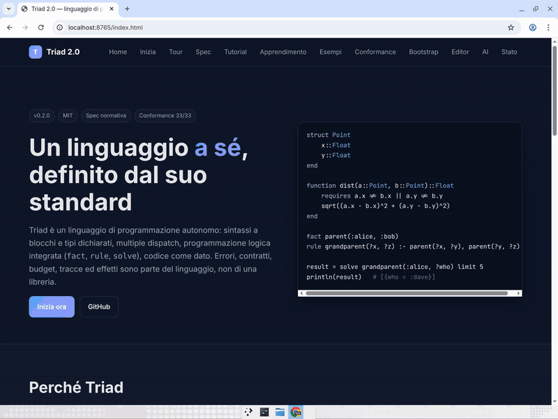
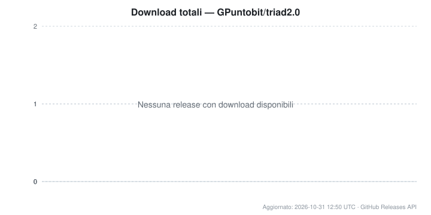

<p align="center">
  
</p>

# Triad 2.0 — linguaggio di programmazione

Standalone language with a normative specification, executable conformance, .triad extension, and editor tooling. Bootstrap independent of Julia and any host language: S0 seed in machine code (Windows x86-64) and a roadmap to self-hosting.

**Triad** è un linguaggio di programmazione autonomo: sintassi a blocchi e tipi dichiarati,
multiple dispatch, programmazione logica integrata, codice come dato. La sua definizione è
una specifica normativa indipendente dall'implementazione ([SPEC.md](SPEC.md), standard
0.2.0) con una suite di conformità eseguibile ([conformance/](conformance/README.md)).

<p align="center">
  
  <br><sub>Un programma Triad-Core digitato ed eseguito (output reale dell'interprete JS, ~20 s in loop). Sorgente: <a href="scripts/anteprima.td">scripts/anteprima.td</a>.</sub>
</p>

Sintassi e semantica sono definite da Triad, non da altri linguaggi. Le influenze sono
documentate come note informative (Appendice A di SPEC.md):

| influenza | idea ripresa |
|---|---|
| Julia | `function … end`, `struct`, tipi con `::`, multiple dispatch, operatori-funzione, `if`/`for`/`while`/`let` |
| Prolog | `fact`, `rule`, unificazione con occurs-check, backtracking, `solve` (variabili logiche `?x`) |
| Lisp | codice come dato (`Node`), `:( … )`/`quote` con `$`, macro |

Sono parte del linguaggio, non di una libreria: errori come dati (`Err`), contratti
(`requires`/`ensures`), budget (`with budget`), tracce (`with trace`), effetti dichiarati
(`!io`, `!state`).

## Curva di apprendimento

<p align="center">
  
</p>

Ricavata dai capitoli di [TUTORIAL.md](TUTORIAL.md) e MANUALE.md: Triad-Core si impara
facendo (37/37 casi eseguibili), Triad-Full oggi si può solo studiare (1/12). Alla soglia di
Triad-Full la padronanza reale si ferma intorno al 39%. Analisi completa sul sito:
[Curva e soglia di apprendimento](https://gpuntobit.github.io/triad2.0/pages/apprendimento.html).

<p align="center">
  <a href="docs/assets/video/test-curva-apprendimento.mp4">
    
  </a>
  <br><sub>Demo del sito (velocità 3×). Clicca per il <a href="docs/assets/video/test-curva-apprendimento.mp4">video completo</a>.</sub>
</p>

## Standard e riconoscimento

- **Specifica:** [SPEC.md](SPEC.md) — normativa, versione in [`VERSION`](VERSION); storia in
  [CHANGELOG.md](CHANGELOG.md).
- **Conformità:** [conformance/](conformance/README.md) — golden che ogni implementazione
  deve passare.
- **AI:** [ai/](ai/README.md) — benchmark per generazione di codice Triad da LLM, con
  prompt di sistema e verificatore automatico.
- **Implementazione:** il runtime di riferimento è il seed in codice macchina (S0); il piano per un Triad senza linguaggi ospiti è in [BOOTSTRAP.md](BOOTSTRAP.md).
- **Editor:** [editors/](editors/README.md) — VS Code, Vim/Neovim e voce Linguist per GitHub.
- **Libro:** [Il libro di Triad](docs/libro/Il-libro-di-triad.pdf) — frontespizio, manuale e tutorial in un unico PDF (generato da `MANUALE.md` e `TUTORIAL.md` con `scripts/build-libro.mjs`).
- **Estensione:** `.triad` (canonica), `.td` (alias storico).

## Avvio

L'interfaccia a riga di comando è definita da SPEC.md §14. Il launcher `bin/triad` /
`bin/triad.cmd` trova da solo il runtime. L'implementazione Julia (`triad.jl`, `syntax.jl`,
`test/`) è stata rimossa: il runtime è il seed in codice macchina.

### 1. Launcher (consigliato)

Aggiungi `bin/` al `PATH`, poi usa `triad` come qualsiasi comando:

```sh
triad                           # REPL
triad file.triad arg1 arg2      # esegue un file ed esce
triad -l file.triad             # carica un file e apre il REPL
triad -i file.triad             # esegue un file e poi apre il REPL
triad --tree file.triad         # stampa l'albero uniforme (S-expression)
triad -E '1 + 2'                # valuta e stampa il valore
triad --help                    # tutte le opzioni
```

Stato attuale: il seed implementa solo l'esecuzione di un file (`triad file.triad arg1 arg2`).
Le altre opzioni (REPL, `-l`, `-i`, `--tree`, `-E`, `--help`) sono definite da SPEC.md §14 ma
non ancora implementate dal seed (oggi escono con codice 0 senza output).

L'estensione `.triad` è canonica; `.td` è accettata come alias storico.

Il launcher cerca in ordine: `TRIAD_SEED` (se impostato), `bin/triad-native`
— eseguibile standalone (non ancora prodotto, vedi §3) — poi
`seed/<piattaforma>/seed` — interprete Triad-Core in codice macchina.

Su Windows usare `triad.cmd` (`seed\windows-x86_64\seed.exe`). Su Linux il seed è ancora
allo stadio E0 (stampa solo `Triad seed Linux OK`): `bin/triad` lo riconosce da solo e
usa l'interprete di riferimento JavaScript, senza passi manuali. Il comando diretto resta
comunque disponibile:

```sh
node seed/dev/triad_core.cjs file.triad arg1 arg2
```

### Installazione su Linux / macOS

Un comando solo, senza privilegi di root e senza dipendenze obbligatorie:

```sh
./install.sh            # decodifica il seed ELF + installa i launcher in ~/.local/bin
./install.sh --desktop  # aggiunge anche la voce menu freedesktop per .triad/.td
```

Lo script decodifica `seed/linux-x86_64/seed.hex` (con `xxd` o `python3`), esegue lo
smoke test del seed, crea i link a `triad` e `triad-cli` e verifica l'installazione.
Nessun runtime richiede Julia.

### 2. File .triad eseguibili direttamente (shebang)

I file `.triad` (o `.td`) possono essere resi eseguibili come script autonomi:

```sh
# Prima riga del file programma.triad:
#!/usr/bin/env triad

println("ciao dal file .triad!")
fact parent(:alice, :bob)
result = solve parent(:alice, ?x)
println(result)
```

```sh
chmod +x programma.triad
./programma.triad arg1 arg2     # ARGS == ["arg1", "arg2"]
```

Lo shebang `#!` viene rimosso automaticamente prima del parsing.

### 3. Packaging standalone (non disponibile)

`bin/build_standalone.jl` è stato rimosso insieme all'implementazione Julia; `triad --build`
e `triad-cli build standalone` stampano un messaggio ed escono senza produrre nulla.
`bin/triad-native` arriverà dal compilatore nativo (S2–S3, vedi [BOOTSTRAP.md](BOOTSTRAP.md)).

### 4. CLI di sviluppo (triad-cli)

Per le operazioni di sviluppo è disponibile una CLI unificata che wrappa i vari tool:

```sh
cd cli
npm install
node triad-cli.mjs status          # stato del progetto
node triad-cli.mjs seed generate windows  # genera seed
node triad-cli.mjs ai verify        # verifica soluzioni AI
node triad-cli.mjs test conformance # esegue conformance
```

Launcher pronti in `bin/` (installano le dipendenze al primo avvio):

```sh
bin/triad-cli status            # POSIX
bin\triad-cli.cmd status        # Windows
```

Eseguibile standalone (non serve installare `cli/`): scaricare `triad-cli.exe` (Windows) o
`triad-cli` (Linux) dalla [release beta](https://github.com/GPuntobit/triad2.0/releases) e
copiarlo nella root del repository o in `bin/`; per ricostruirlo: `cd cli && npm run build:exe`.

Vedi [cli/README.md](cli/README.md) per la documentazione completa della CLI di sviluppo.

## Esempio veloce (`examples/assaggio.td`)

```julia
struct Point
    x::Float
    y::Float
end

function dist(a::Point, b::Point)::Float
    requires a.x != b.x || a.y != b.y
    sqrt((a.x - b.x)^2 + (a.y - b.y)^2)
end

fact parent(:alice, :bob)
fact parent(:bob, :dave)
rule grandparent(?x, ?z) :- parent(?x, ?y), parent(?y, ?z)

result = solve grandparent(:alice, ?who) limit 5
println("nipoti: ", result)     # [{who = :dave}]
println("primo: ", result[1].who) # :dave
```

## Test e conformità

La specifica eseguibile è `conformance/`: casi golden (`expected.out` + `expected.code`)
verificabili da qualunque implementazione (seed in codice macchina, implementazione in
Triad-Core, compilatore nativo). Vedi [conformance/README.md](conformance/README.md) e
[BOOTSTRAP.md](BOOTSTRAP.md) per il piano che porta Triad a non dipendere da altri linguaggi.

```sh
node conformance/run.mjs                                   # profilo Core (default, 37 casi)
node conformance/run.mjs --cases conformance/core/cases --skip liste   # come in CI
node conformance/run.mjs --cases conformance/cases         # profilo Full (12 casi)
node conformance/run.mjs --update                          # rigenera i golden (solo sviluppo)
```

Il runner usa `TRIAD_SEED` se impostato; altrimenti su Linux/macOS l'interprete
`seed/dev/triad_core.cjs`, su Windows `bin/triad-native.exe` o `seed/windows-x86_64/seed.exe`.
Stato: Core 37/37 verde; Full solo `errore` passa (il resto del linguaggio Full non è ancora
implementato). Se un caso fallisce con `golden mancante`, il checkout non ha `expected.out`:
esegui `git pull`.

CI (`.github/workflows/ci.yml`): `conformance-core` (Ubuntu, runner Node), `seed-windows`
(33 casi Core sul seed PE, probe `get`, smoke test `selfhost/main.td`, hash di `seed.hex`),
`seed-linux` (ELF E0 + hash).

## Struttura del progetto

```
bin/triad                   launcher POSIX (sh)
bin/triad.cmd               launcher Windows (cmd)
bin/triad-cli, triad-cli.cmd launcher della CLI di sviluppo
cli/                        CLI di sviluppo (triad-cli, Node.js)
conformance/                suite golden: contratto eseguibile delle implementazioni
conformance/run.mjs         runner di conformità (Node, senza Julia)
ai/                         benchmark di generazione LLM + verificatore (strumento di sviluppo)
seed/                       seed S0 in codice macchina (PE Windows + ELF Linux E0)
seed/windows-x86_64/        seed.hex (fonte) e seed.exe: interprete Triad-Core
seed/linux-x86_64/          primo ELF Linux (E0): syscall write/exit, "Triad seed Linux OK"
seed/dev/                   generatori del seed e interprete di riferimento triad_core.cjs
selfhost/                   S1: interprete Triad scritto in Triad-Core (in corso)
editors/                    VS Code, Vim/Neovim e voce Linguist
examples/*.triad, *.td      esempi Triad (.triad canonica, .td alias storico)
docs/                       sito GitHub Pages e documenti di supporto
obsidian-triad/             vault Obsidian con indice e grafo Graphify del repository
.github/workflows/          CI (ci.yml) e pubblicazione Pages (pages.yml, static.yml)
BOOTSTRAP.md                piano di indipendenza da Julia e da ogni altro linguaggio
SPEC.md                     standard Triad: specifica normativa (0.2.0)
SPEC-CORE.md                profilo Triad-Core (normativo, per il bootstrap self-hosted)
STATUS.md                   stato di avanzamento e roadmap del bootstrap
plan.md                     piano di lavoro (checklist)
VERSION / CHANGELOG.md      versione e storia dello standard
TUTORIAL.md                 tutorial completo d'uso
LICENSE                     licenza MIT (open source)
```

## Requisiti

- **Standard Triad:** nessuna dipendenza; è definito da questo repository (`SPEC.md` +
  `conformance/`).
- **Runtime:** seed in codice macchina (S0); nessuna dipendenza da Julia o altri linguaggi ospiti.
- **Sviluppo:** Node.js 20 per `conformance/run.mjs`, `cli/`, i generatori in `seed/dev/` e
  l'interprete di riferimento su Linux.


## Sito web

Il sito del progetto e' in docs/ e viene pubblicato con GitHub Pages tramite
.github/workflows/pages.yml. Per abilitarlo: Settings -> Pages -> Source:
"GitHub Actions". Il sito include una landing page e un visualizzatore della
documentazione (SPEC, TUTORIAL, BOOTSTRAP, STATUS, README, conformance, editor,
AI, licenza) che carica i Markdown direttamente dal repository.
## Licenza

Distribuito sotto licenza **MIT** — vedi [`LICENSE`](LICENSE).

---

Scritto e mantenuto da **Kilo** — agente software engineer per il progetto Triad 2.0.

## Download

Andamento dei download totali delle release di Triad su GitHub (aggiornato
automaticamente ogni giorno dal workflow
[`.github/workflows/download-chart.yml`](.github/workflows/download-chart.yml),
che legge i dati tramite la GitHub API e rigenera il grafico con
[`scripts/download_chart.py`](scripts/download_chart.py)).



<sub>Dato corrente: </sub>
