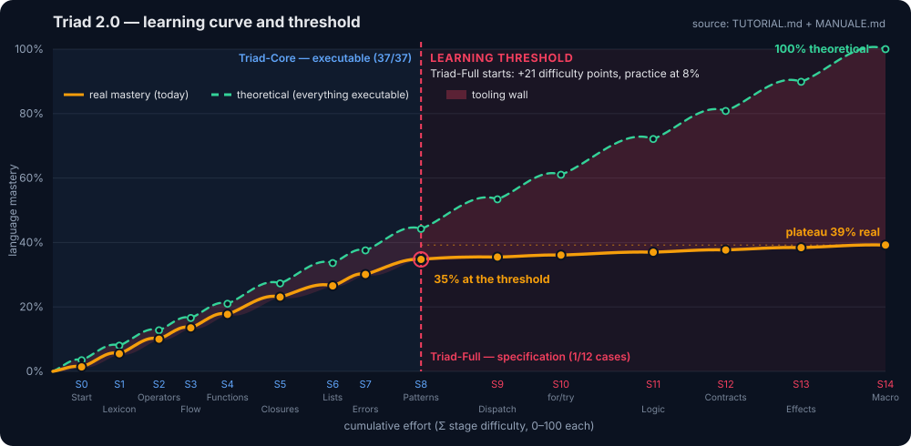
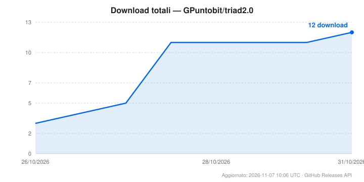

<p align="center">
  
</p>

# Triad 2.0 — Programming Language  
A standalone language with a normative specification, executable conformance, `.triad` extension, and editor tooling. Bootstrap independent of Julia and any host language: S0 seed in machine code (Windows x86-64 PE + Linux x86-64 ELF) and a roadmap to self-hosting.

Triad is a standalone programming language featuring block syntax, declared types, multiple dispatch, integrated logic programming, and code-as-data. Its definition is an implementation-independent normative specification ([SPEC.md](SPEC.md), standard 0.2.0) accompanied by an executable conformance suite ([conformance/](conformance/README.md)). 

https://github.com/user-attachments/assets/2e01cb37-ea17-44af-a92b-7636bdaee3d5
<p align="center">
  <video src="docs/assets/video/anteprima-codice.mp4" controls width="552"></video>
  <br><sub>A demonstration of Triad-Core syntax. The supported runtime is now the native machine-code seed. Video: <a href="docs/assets/video/anteprima-codice.mp4">MP4</a>.</sub>
  <br><sub>A typed and executed Triad-Core program (archived demonstration from an earlier development interpreter). Video: <a href="docs/assets/video/anteprima-codice.mp4">MP4</a>.</sub>
</p>
<p align="center">
  
  <br><sub>A typed "Hello, World!" in Triad-Core (animated SVG, looping).</sub>
</p>


Syntax and semantics are defined by Triad, not by other languages. Influences are documented as informative notes (Appendix A of SPEC.md):

| Influence  |  Borrowed idea |
|---|---|
| Julia | `function … end`, `struct`, tipi con `::`, multiple dispatch, operatori-funzione, `if`/`for`/`while`/`let` |
| Prolog | `fact`, `rule`, unificazione con occurs-check, backtracking, `solve` (variabili logiche `?x`) |
| Lisp | codice come dato (`Node`), `:( … )`/`quote` con `$`, macro |

They are part of the language, not a library: errors as data (Err), contracts (requires/ensures), budgets (with budget), traces (with trace), and declared effects (!io, !state).

## Logic engine (first S1 profile)

The facts/rules example can now run without a host-language runtime:

```sh
./bin/triad --logic program.triad
```

The profile supports unification with occurs-check, iterative backtracking,
recursive rules, solution access and comprehensions. It is not complete
Triad-Full: see [supported syntax and limits](selfhost/logic/README.md).

## Learning curve

<p align="center">
  
</p>

Derived from the chapters in [docs/tutorial/TUTORIAL.md](docs/tutorial/TUTORIAL.md) and [docs/MANUALE.md](docs/MANUALE.md): Triad-Core is learned by doing (42/42 executable cases), while Triad-Full can only be studied at present (1/12). At the Triad-Full threshold, actual mastery plateaus around 39%. Full analysis on the website: [Learning curve and threshold](https://gpuntobit.github.io/triad2.0/pages/apprendimento.html).

https://github.com/user-attachments/assets/22802bf3-1028-4696-8a2a-f65271100d5b
<p align="center">
  <video src="docs/assets/video/test-curva-apprendimento.mp4" controls width="800"></video>
  <br><sub>Website demo (3× speed). Full video: <a href="docs/assets/video/test-curva-apprendimento.mp4">MP4</a>.</sub>
</p>

## Standards and Recognition

- **Specification:** [SPEC.md](SPEC.md) — normative, version in [`VERSION`](VERSION); history in
  [CHANGELOG.md](CHANGELOG.md).
- **Conformance:** [conformance/](conformance/README.md) — golden tests that every implementation
  must pass.
- **AI:** [ai/](ai/README.md) — benchmark for Triad code generation by LLMs, with
  system prompts and an automatic verifier.
- **Implementation:** the runtime is the native machine-code seed (S0); the plan for a self-hosted toolchain is in [BOOTSTRAP.md](BOOTSTRAP.md).
- **Editors:** [editors/](editors/README.md) — VS Code, Vim/Neovim, and a GitHub Linguist entry.
- **Extension:** `.triad` (canonical), `.td` (historical alias).

## Startup

The command-line interface is defined in SPEC.md §14. The runtime is the machine code
seed: the `bin/triad` / `bin/triad.cmd` launcher always executes it — no host language,
no Node.js on the user path. The Julia implementation (`triad.jl`, `syntax.jl`, `test/`)
has been removed.

### 1. Install (recommended, Linux x86-64)

```sh
git clone https://github.com/GPuntobit/triad2.0.git && cd triad2.0
./install.sh                      # decodes the seed, installs the launchers
triad tuo_programma.td             # runs a Triad program
```

`install.sh` installs `triad` and `triad-cli` as absolute-path wrappers in
`~/.local/bin` (or `--prefix DIR`) and performs a byte-exact smoke test
(`tests/probes/test_simple.td` against its golden) that **fails the install on
mismatch**. No dependencies beyond a POSIX shell: the seed is decoded with
`printf` alone.

Prebuilt seeds are attached to every beta release: `seed.exe` (Windows PE) and
`seed-linux-x86_64` (static ELF, no libc — 8.6 KB, no Wine needed) — see the
[releases page](https://github.com/GPuntobit/triad2.0/releases).

To install or refresh the application menu entry, run `./install.sh --desktop`.
This also registers the `.triad`/`.td` MIME type and selects Triad Program as its
default application for double-click opening (using `update-mime-database` and
`xdg-mime` when available).
The menu opens a persistent terminal session: enter a `.triad`/`.td` file path
without quotes, or `:quit` to close it. Opening an associated file runs it and
keeps results and errors visible. The seed currently requires a file; the REPL
specified in SPEC.md §14 remains unimplemented.

### 2. CLI

```sh
triad program.td [args...]         # run a Triad program (.triad/.td)
triad-cli status                   # toolchain and environment status
triad-cli test all                 # full gate: conformance + probes
```

Legacy JavaScript development commands have been retired from the working tree. Advanced seed regeneration, AI verification and extension tooling require new native implementations; they are not available through the current CLI:

```sh
triad-cli status          # native CLI status
triad-cli test all        # Core and S1 conformance
sh scripts/no-js.sh      # checks that JavaScript sources/tooling are absent
```

For current supported capabilities, use the native `bin/triad` and POSIX `bin/triad-cli` launchers. Development features removed with the JavaScript tools require native replacements.

See [cli/README.md](cli/README.md) for the complete development CLI documentation.
Advanced seed regeneration, the foreign-language reference oracle, the
browser playground and the old development CLI have been retired. The
native **Triad-to-seed generator is not implemented yet**: the committed
machine-code ELF/PE dumps remain hash-verified but cannot currently be
recreated from a Triad-native generator.

For details, remaining work and known feature losses, see
[JavaScript removal and native migration](docs/NO_JAVASCRIPT_MIGRATION.md).

## Quick Example (`examples/assaggio.td`)

```triad
struct Point
    x::Float
    y::Float
end

function dist(a::Point, b::Point)::Float
    requires a.x != b.x || a.y != b.y
    sqrt((a.x - b.x)^2 + (a.y - b.y)^2)
end

fact parent(:alice, :bob)
fact parent(:bob, :dave)
rule grandparent(?x, ?z) :- parent(?x, ?y), parent(?y, ?z)

result = solve grandparent(:alice, ?who) limit 5
println("grandchildren: ", result)     # [{who = :dave}]
println("first: ", result[1].who) # :dave
```

## Testing and Conformance

The executable specification is `conformance/`: golden cases (`expected.out` + `expected.code`) verifiable by any implementation (machine code seed, Triad-Core implementation, native compiler). See [conformance/README.md](conformance/README.md) and [BOOTSTRAP.md](BOOTSTRAP.md) for the plan to make Triad independent of other languages.

```sh
sh verify.sh                       # full gate: conformance + probes (no Node)
sh conformance/run.sh              # Core profile, 39 cases, byte-exact
sh conformance/run.sh --update     # regenerates goldens (development only)
sh tests/probes/run_probes.sh      # probes ok_*/test_*/bad_* + S1 golden
```

The harness runs the native seed in the repository (`seed/linux-x86_64/seed`;
override with `TRIAD_SEED`), with byte-exact `cmp` against the golden sidecars.
Status: Core 42/42 green byte-exact on both the PE and the ELF seeds; Full only
`error` passes (the rest of the Full language is not yet implemented). If a case
fails with a missing golden, the checkout lacks `expected.out`: run `git pull`.

CI (`.github/workflows/ci.yml`) checks the native Core/S1 conformance,
TRID experimental and graph tests, native seed SHA-256 integrity, installation,
security, static documentation generation and the no-JavaScript source gate.
The retired JS oracle's differential coverage is **not yet restored**.

## Project Structure

```text
bin/                        POSIX and Windows native launchers (triad, triad-cli)
bin/                        POSIX and Windows launchers (triad, triad-cli)
bin/triad-cli               POSIX native CLI (run, test, status)
conformance/                golden suite: executable contract for implementations
conformance/run.sh          conformance harness (POSIX, without Node)
seed/                       S0 machine code seed (Windows PE + Linux ELF E2)
seed/windows-x86_64/        seed.hex (source) and seed.exe: Triad-Core interpreter
seed/linux-x86_64/          seed.hex (source) and seed: Triad-Core interpreter (ELF E2)
seed/dev/                   historical maintenance documentation; JavaScript generators removed
seed/dev/                   native bootstrap contracts and archived technical documentation
selfhost/                   S1: Triad interpreter written in Triad-Core (in progress)
scripts/docs/               native/Python document utilities and download chart
scripts/seed-runner/        seed experiment harnesses (wine runner for the PE)
scripts/experiments/        LLM streaming/translation experiment scripts
tools/                      retained non-JavaScript developer utilities
tools/site-gen/             Triad-native static-site generators and POSIX driver
tools/site-jekyll/          legacy Jekyll scaffold (the Pages site is deployed from docs/)
editors/                    VS Code, Vim/Neovim, and Linguist entry
examples/*.triad, *.td      Triad examples (.triad canonical, .td historical alias)
tests/probes/               small Core probe programs used by CI and install.sh
tests/security/             repeatable security tests (where.exe trust, git path, ReDoS, pin SHA)
ai/                         LLM generation benchmark + verifier (development tool)
docs/                       GitHub Pages site and long-form documentation
docs/MANUALE.md             full manual (Core + Full presented together)
docs/tutorial/              complete usage tutorial + translations (.md, .it, .ru, .zh, .ja)
docs/wiki/                  English project wiki (Home, Getting Started, Language Guide, ...)
docs/security/              security review, backlog triage and severity triage records
docs/releases/              per-version release notes
docs/worklog/               PR descriptions (current draft + archived)
obsidian-triad/             Markdown vault (vendored JavaScript plugins removed)
.github/workflows/          Native CI (ci.yml), static Pages publishing (pages.yml)
BOOTSTRAP.md                plan for independence from Julia and any other language
SPEC.md                     Triad standard: normative specification (0.2.0)
SPEC-CORE.md                Triad-Core profile (normative, for self-hosted bootstrap)
STATUS.md / TASK.md         bootstrap progress status, roadmap, task log
SECURITY.md                 vulnerability reporting policy
plan.md                     work plan (checklist)
VERSION / CHANGELOG.md      standard version and history
README.md / docs/tutorial/TUTORIAL.md  introduction and complete usage tutorial
LICENSE                     MIT license (open source)
```

## Requirements

- **Triad Standard:** no dependencies; it is defined by this repository (`SPEC.md` + `conformance/`).
- **Runtime:** machine code seed (S0); no dependencies on Julia or other host languages.
  Execution requires an x86-64 platform (Windows PE or Linux ELF seed).
- **Development:** no Node.js/npm source or runtime is part of the checked-out tree. Native bootstrap, conformance and the supported development commands use Triad or POSIX shell; features without a native replacement remain unavailable.
- **Development:** POSIX shell, core system tools and the committed native
  Triad seed. No JavaScript runtime or npm dependency is shipped.
  Seed source regeneration is not yet supported in the native toolchain.

### Termux (Android) and non-x86-64 platforms

The S0 seeds are native executables for x86-64 only (`seed/windows-x86_64/seed.exe`, `seed/linux-x86_64/seed`) and cannot run on Android devices, which are ARM64. There is no ARM64 native seed yet (see [STATUS.md](STATUS.md)); `bin/triad` always executes the seed and reports a clear error where no seed can run.

On Termux (Android ARM64) and other platforms without a supported x86-64 native seed, **local execution is not supported yet**. A Triad-native ARM64 seed or a compatible native port is required. No JavaScript fallback interpreter is shipped, and the launcher never delegates to Node.js.

## Website

The project website is in `docs/` and is published with GitHub Pages. It consists of static HTML/CSS; it does not execute Triad inside the browser. Run source files locally with the native seed.
The former development reference interpreter has been removed. ARM64
execution requires a future native seed or compiler port. The project does
**not** fall back to a scripting-language interpreter on unsupported systems.

## Website

The project website is in `docs/` and is published via GitHub Pages using `.github/workflows/pages.yml`. To enable it: Settings -> Pages -> Source: "GitHub Actions". The site contains static HTML/CSS/SVG documentation. The browser playground was retired; Triad programs run with the native seed. The pages can be regenerated using `sh tools/site-gen/build.sh --dry-run`.

## License

Distributed under the **MIT License** — see [`LICENSE`](LICENSE).

---

Written and maintained by **Kilo** — software engineer agent for the Triad 2.0 project.

## Downloads

Trend of total downloads of Triad releases on GitHub (automatically updated daily by the [`.github/workflows/download-chart.yml`](.github/workflows/download-chart.yml) workflow, which reads data via the GitHub API and regenerates the chart with [`scripts/download_chart.py`](scripts/download_chart.py)).



<sub>Current data: </sub>
