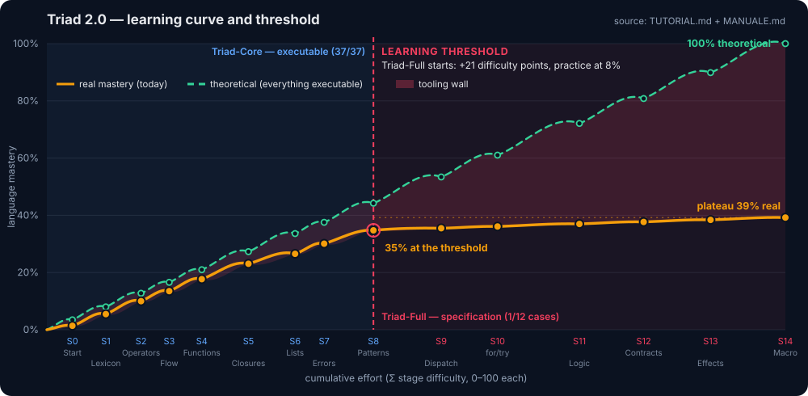

<p align="center">
  
</p>

[Il libro di triad (Books) - Italian Edition](https://a.co/d/0iwB7IdX)

# Triad 2.0 — Programming Language  
A standalone language with a normative specification, executable conformance, `.triad` extension, and editor tooling. Bootstrap independent of Julia and any host language: S0 seed in machine code (Windows x86-64) and a roadmap to self-hosting.

Triad is a standalone programming language featuring block syntax, declared types, multiple dispatch, integrated logic programming, and code-as-data. Its definition is an implementation-independent normative specification ([SPEC.md](SPEC.md), standard 0.2.0) accompanied by an executable conformance suite ([conformance/](conformance/README.md)). 

https://github.com/user-attachments/assets/2e01cb37-ea17-44af-a92b-7636bdaee3d5
<p align="center">
  <video src="docs/assets/video/anteprima-codice.mp4" controls width="552"></video>
  <br><sub>A typed and executed Triad-Core program (actual output from the JS interpreter, ~35s in a loop). Video: <a href="docs/assets/video/anteprima-codice.mp4">MP4</a>.</sub>
</p>
<p align="center">
  
  <br><sub>A typed "Hello, World!" in Triad-Core (animated SVG, looping).</sub>
</p>


Syntax and semantics are defined by Triad, not by other languages. Influences are documented as informative notes (Appendix A of SPEC.md):

| Influence  |  Borrowed idea |
|---|---|
| Julia | `function … end`, `struct`, tipi con `::`, multiple dispatch, operatori-funzione, `if`/`for`/`while`/`let` |
| Prolog | `fact`, `rule`, unificazione con occurs-check, backtracking, `solve` (variabili logiche `?x`) |
| Lisp | codice come dato (`Node`), `:( … )`/`quote` con `$`, macro |

They are part of the language, not a library: errors as data (Err), contracts (requires/ensures), budgets (with budget), traces (with trace), and declared effects (!io, !state).

## Learning curve

<p align="center">
  
</p>

Derived from the chapters in [tutorial/TUTORIAL.md](tutorial/TUTORIAL.md) and [docs/MANUALE.md](docs/MANUALE.md): Triad-Core is learned by doing (37/37 executable cases), while Triad-Full can only be studied at present (1/12). At the Triad-Full threshold, actual mastery plateaus around 39%. Full analysis on the website: [Learning curve and threshold](https://gpuntobit.github.io/triad2.0/pages/apprendimento.html).

https://github.com/user-attachments/assets/22802bf3-1028-4696-8a2a-f65271100d5b
<p align="center">
  <video src="docs/assets/video/test-curva-apprendimento.mp4" controls width="800"></video>
  <br><sub>Website demo (3× speed). Full video: <a href="docs/assets/video/test-curva-apprendimento.mp4">MP4</a>.</sub>
</p>

## Standards and Recognition

- **Specification:** [SPEC.md](SPEC.md) — normative, version in [`VERSION`](VERSION); history in
  [CHANGELOG.md](CHANGELOG.md).
- **Conformance:** [conformance/](conformance/README.md) — golden tests that every implementation
  must pass.
- **AI:** [ai/](ai/README.md) — benchmark for Triad code generation by LLMs, with
  system prompts and an automatic verifier.
- **Implementation:** the reference runtime is the machine code seed (S0); the plan for a Triad without host languages is in [BOOTSTRAP.md](BOOTSTRAP.md).
- **Editors:** [editors/](editors/README.md) — VS Code, Vim/Neovim, and a GitHub Linguist entry.
- **Extension:** `.triad` (canonical), `.td` (historical alias).

## Startup

The command-line interface is defined in SPEC.md §14. The `bin/triad` /
`bin/triad.cmd` launcher automatically locates the runtime. The Julia implementation (`triad.jl`, `syntax.jl`,
`test/`) has been removed: the runtime is the machine code seed.

### 1. Launcher (recommended)

Add `bin/` to your `PATH`, then use `triad` like any other command:

```sh
node triad-cli.mjs status          # project status
node triad-cli.mjs seed generate windows  # generates seed
node triad-cli.mjs ai verify        # verifies AI solutions
node triad-cli.mjs test conformance # runs conformance
```

Launchers ready in `bin/` (they install dependencies on first run):

```sh
bin/triad-cli status            # POSIX
bin\triad-cli.cmd status        # Windows
```

Standalone executable (no need to install `cli/`): download `triad-cli.exe` (Windows) or `triad-cli` (Linux) from the [beta release](https://github.com/GPuntobit/triad2.0/releases) and copy it to the repository root or `bin/`; to rebuild it: `cd cli && npm run build:exe`.

See [cli/README.md](cli/README.md) for the complete development CLI documentation.

## Quick Example (`examples/assaggio.td`)

```julia
struct Point
    x::Float
    y::Float
end

function dist(a::Point, b::Point)::Float
    requires a.x != b.x || a.y != b.y
    sqrt((a.x - b.x)^2 + (a.y - b.y)^2)
end

fact parent(:alice, :bob)
fact parent(:bob, :dave)
rule grandparent(?x, ?z) :- parent(?x, ?y), parent(?y, ?z)

result = solve grandparent(:alice, ?who) limit 5
println("grandchildren: ", result)     # [{who = :dave}]
println("first: ", result[1].who) # :dave
```

## Testing and Conformance

The executable specification is `conformance/`: golden cases (`expected.out` + `expected.code`) verifiable by any implementation (machine code seed, Triad-Core implementation, native compiler). See [conformance/README.md](conformance/README.md) and [BOOTSTRAP.md](BOOTSTRAP.md) for the plan to make Triad independent of other languages.

```sh
node conformance/run.mjs                                   # Core profile (default, 37 cases)
node conformance/run.mjs --cases conformance/core/cases --skip lists   # as in CI
node conformance/run.mjs --cases conformance/cases         # Full profile (12 cases)
node conformance/run.mjs --update                          # regenerates goldens (development only)
```

The runner uses `TRIAD_SEED` if set; otherwise, on Linux/macOS it uses the `seed/dev/triad_core.cjs` interpreter, and on Windows `bin/triad-native.exe` or `seed/windows-x86_64/seed.exe`. 
Status: Core 37/37 green; Full only `error` passes (the rest of the Full language is not yet implemented). If a case fails with a missing golden, the checkout lacks `expected.out`: run `git pull`.

CI (`.github/workflows/ci.yml`): `conformance-core` (Ubuntu, Node runner), `seed-windows` (33 Core cases on the PE seed, `get` probe, smoke test `selfhost/main.td`, `seed.hex` hash), `seed-linux` (ELF E0 + hash).

## Project Structure

```text
bin/                        POSIX and Windows launchers (triad, triad-cli)
cli/                        development CLI (triad-cli, Node.js)
conformance/                golden suite: executable contract for implementations
conformance/run.mjs         conformance runner (Node, without Julia)
probes/                     small Core probe programs used by CI and install.sh
seed/                       S0 machine code seed (Windows PE + Linux ELF E0)
seed/windows-x86_64/        seed.hex (source) and seed.exe: Triad-Core interpreter
seed/linux-x86_64/          first Linux ELF (E0): write/exit syscalls, "Triad seed Linux OK"
seed/dev/                   seed generators and triad_core.cjs reference interpreter
selfhost/                   S1: Triad interpreter written in Triad-Core (in progress)
scripts/docs/               book/EPUB/DOCX builders, download chart, Triad-generated site
scripts/seed-runner/        Windows batch harnesses for seed experiments
scripts/experiments/        LLM streaming/translation experiment scripts
tools/                      developer utilities (webcmd-graphify plugin, push helper)
editors/                    VS Code, Vim/Neovim, and Linguist entry
examples/*.triad, *.td      Triad examples (.triad canonical, .td historical alias)
tests/security/             repeatable security tests (where.exe trust, git path, ReDoS, pin SHA)
ai/                         LLM generation benchmark + verifier (development tool)
docs/                       GitHub Pages site and long-form documentation
docs/MANUALE.md             full manual (Core + Full presented together)
docs/releases/              per-version release notes
docs/worklog/               PR descriptions (current draft + archived)
tutorial/                   complete usage tutorial + translations (.md, .it, .ru, .zh, .ja)
obsidian-triad/             Obsidian vault with index and Graphify graph of the repository
.github/workflows/          CI (ci.yml) and Pages publishing (pages.yml, static.yml)
BOOTSTRAP.md                plan for independence from Julia and any other language
SPEC.md                     Triad standard: normative specification (0.2.0)
SPEC-CORE.md                Triad-Core profile (normative, for self-hosted bootstrap)
STATUS.md / TASK.md         bootstrap progress status, roadmap, task log
SECURITY.md                 vulnerability reporting policy
plan.md                     work plan (checklist)
VERSION / CHANGELOG.md      standard version and history
README.md / tutorial/TUTORIAL.md  introduction and complete usage tutorial
LICENSE                     MIT license (open source)
```

## Requirements

- **Triad Standard:** no dependencies; it is defined by this repository (`SPEC.md` + `conformance/`).
- **Runtime:** machine code seed (S0); no dependencies on Julia or other host languages.
- **Development:** Node.js 20 for `conformance/run.mjs`, `cli/`, the generators in `seed/dev/`, and the reference interpreter on Linux.

### Termux (Android)

The S0 seeds are native executables for x86-64 only (`seed/windows-x86_64/seed.exe`, `seed/linux-x86_64/seed`) and cannot run on Android devices, which are ARM64. There is no ARM64 native seed yet (see [STATUS.md](STATUS.md)). On Termux, Triad runs through the Node.js reference interpreter fallback (`seed/dev/triad_core.cjs`), exactly like the conformance runner does on platforms without a usable seed:

```sh
pkg install nodejs git
git clone https://github.com/GPuntobit/triad2.0.git && cd triad2.0
export PATH="$PWD/bin:$PATH"
printf 'x = 6 * 7\nprintln(x)\n' > demo.td
triad demo.td                     # prints 42 via the Node.js fallback interpreter
node conformance/run.mjs          # full Core suite passes on Termux (37/37)
```

Notes:

- `bin/triad` finds no runnable native seed on Android and transparently executes programs with `node seed/dev/triad_core.cjs`; the only runtime requirement on Termux is therefore `pkg install nodejs`.
- The same fallback covers any architecture without a prebuilt x86-64 seed (ARM64 Linux, macOS).
- Shebang scripts (`#!/usr/bin/env triad` + `chmod +x file.td`) work as long as `bin/` is in the `PATH`.
- On Termux you can run Triad-Core programs (the subset covered by the conformance suite); Triad-Full constructs still require the future self-hosted runtime ([BOOTSTRAP.md](BOOTSTRAP.md)).

## Website

The project website is in `docs/` and is published via GitHub Pages using `.github/workflows/pages.yml`. To enable it: Settings -> Pages -> Source: "GitHub Actions". The site includes a landing page and a documentation viewer (SPEC, TUTORIAL, BOOTSTRAP, STATUS, README, conformance, editor, AI, license) that loads Markdown directly from the repository.

## License

Distributed under the **MIT License** — see [`LICENSE`](LICENSE).

---

Written and maintained by **Kilo** — software engineer agent for the Triad 2.0 project.

## Downloads

Trend of total downloads of Triad releases on GitHub (automatically updated daily by the [`.github/workflows/download-chart.yml`](.github/workflows/download-chart.yml) workflow, which reads data via the GitHub API and regenerates the chart with [`scripts/download_chart.py`](scripts/download_chart.py)).


<sub>Current data: </sub>
